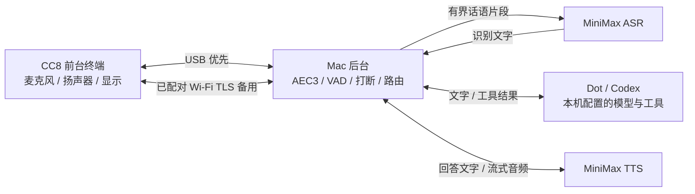

# 大黄蜂架构与通信

## 各端职责

CC8 的 Java 应用采集 16 kHz PCM16 单声道麦克风音频，播放流式 PCM，上传实际写入 AudioTrack 的播放参考与设备时间戳。头像嘴型跟随播放包络，字幕用 MiniMax 词时间戳与 AudioTrack 播放头逐字高亮；这是包络嘴型，不是音素级口型。相机目前仅有用户主动启动的 20 秒本地预览检测页，未接入视觉大脑。

Mac 运行 WebRTC AEC3、NS、VAD、回声匹配、本地快速停止词检测与轮次管理。可信近端语音出现后先暂停播报；识别确认新问题再取消旧轮次，噪声 / 回声才恢复原缓冲。只有本轮仍有效的文字、音频、来源和字幕可到达设备。

默认将处理后的有界讲话片段以内存 WAV 交给 MiniMax ASR，不连续上传整路麦克风；识别文字交给 Dot，回答交给 MiniMax TTS。Dot 使用本机已登录的 Codex CLI app-server、独立临时语音上下文，继承本机模型、推理、技能、插件 / MCP 与权限配置；不读取当前桌面聊天历史，桌面 UI 专有能力不保证继承。审批请求不会自动批准。MiniMax 对话模式和本地 SenseVoice 是可显式选择的替代方案，不静默降级。

## 双通道

| 通道 | 方向 / 端口 | 用途 |
| --- | --- | --- |
| USB | CC8 回环 `127.0.0.1:18765`，Mac 经工程 shell / 系统 nc 接入 | 首次配对和最高优先级音频控制通道 |
| 局域网 TLS | CC8 主动连接已配对 Mac 的 TCP 18766 | Wi-Fi 备用；证书 SHA-256 固定校验 + 配对令牌认证 |
| UDP 发现 | 局域网 UDP 18767 | HMAC 签名的发现与响应，不以明文广播配对令牌 |
| Mac 本地 IPC | Unix socket，0600 | 指定文字播报 / 状态与受限控制 |

首次 USB 通道验证成功后，Mac 将本地生成的配对配置经 USB 发送给应用。配对私钥 / 令牌只存在 Mac 忽略目录和 Android 应用私有存储中。无需网络 ADB、Root 或固定私网 IP。

USB 与 Wi-Fi 都就绪时只选择 USB 处理音频；拔掉数据线后选择已认证 Wi-Fi，USB 恢复后自动切回。切换使旧播报失效，丢弃旧轮次数据；已由用户开启的采集可在已准备好的认证通道间延续。两条通道都断开必须停止采集，重新连接不能自行开麦。

Mac 与 CC8 需要位于能互通的局域网。访客隔离、跨 VLAN、UDP 广播限制或防火墙可能阻止发现 / 连接。只允许应用所需本地通信，不需开放公网端口。

## 使用约束

麦克风只在前台由用户点“开始语音”并授权后开启；后台或通道全断会关闭。语音唤醒是 ASR 后文字匹配“大黄蜂 / Bumblebee”，需要用户已开启麦克风与 Mac 服务，并非独立低功耗硬件唤醒。

15 分钟无交互后进入应用内黑色待机与最低窗口亮度；Activity 仍在前台，唤醒恢复界面。它不是关闭设备显示电源。未开启麦克风时仍可接受用户明确指定的文字播报，但不能语音打断，设备停止按钮继续可用。

默认不保存原始录音。云端 ASR / Dot 模型 / TTS 分别使用其服务的凭证和额度；本仓库不复制原开发机登录状态或服务密钥。
