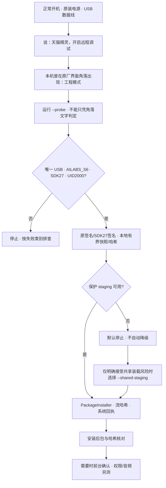

# 正常 Android 安装路线图与排障（F-16）

下图为**流程示意，不是设备截图或一次安装成功记录**。已验证固件/权限见 [兼容表](COMPATIBILITY.md)，完整命令见 [APK_INSTALL](APK_INSTALL.md)。目前没有可发布的脱敏工程入口截图/GIF；F-16 的真实图像演示仍待补，不用示意图冒充。

整个流程不要求关机组合键、BootROM、分区操作、Root 或网络 ADB。工程模式仅为当前单机实测入口；无该入口时不要照搬其他型号的解锁教程。

| 失败阶段 | 观察/判定 | 下一步 |
| --- | --- | --- |
| 电脑准备 | tools/JDK 缺失、helper/source 哈希不符 | 运行 doctor 对应 profile，重新构建 helper；不手改 SHA |
| USB 选择 | 无设备、unauthorized、offline、多目标 | 正常 Android / 数据线 / 设备授权，隔离唯一目标；不猜 transport，不试网络 ADB |
| 工程 shell | closed、输出不完整、UID/model/SDK 不符 | 停止；记录四字段/错误类别和固件版本；不绕过硬编码身份检查 |
| APK 预检 | SDK27 验签失败、完整证书集合不匹配 | 按 SIGNING 引用原私钥重建；不卸载旧应用或清数据 |
| staging | Protected staging is blocked | 已停止；只有明确接受设备其他存储应用可替换助手的风险，才显式选择 shared-staging；哈希不能消除此装载竞态 |
| 安装流 | 字节数/传输哈希不符、无系统成功回执 | 不算成功；核对本地完整单 APK、空间、ABI/API；不要改校验或只重放命令当作成功 |
| 安装后验证 | 包已装但安装后哈希不可读/不匹配 | “已安装但未完整验证”，不自动重装/卸载；先检查实际已装包状态 |
| 报告保存 | 安装动作完成后，本机保存报告失败 | 先核对安装回执和已装包，检查本机私有目录/磁盘权限；不要仅为存报告再次安装 |
| 启动 | launch 命令受理但未确认前台 | 核对实际 Activity/页面和启动错误；不宣称已打开 |
| 音频/视觉 | 有页面但无声、无权限或预览失败 | 前台运行单独音频/相机检查；维护打开用 --no-auto-voice，不为排查任意开麦/相机 |
| 黑屏/无法正常开机 | 无正常 Android 可探测状态 | 停止本流程；使用已有官方设备支持，不加入未经验证的组合键或固件写入 |

真实截图补充时必须注明本机固件、采集日期和步骤，遮盖账号/设备唯一标识/配对等内容；仅展示工程入口或系统权限，不公开用户相机画面。演示不能代替脚本 UID/型号/SDK、签名、传输哈希和系统回执核验。
